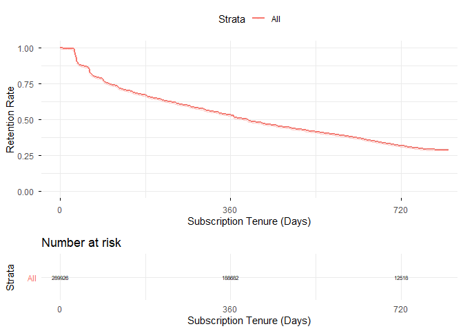
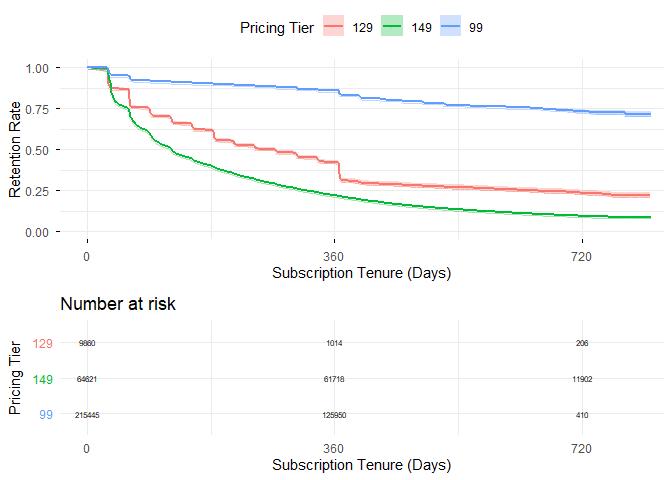
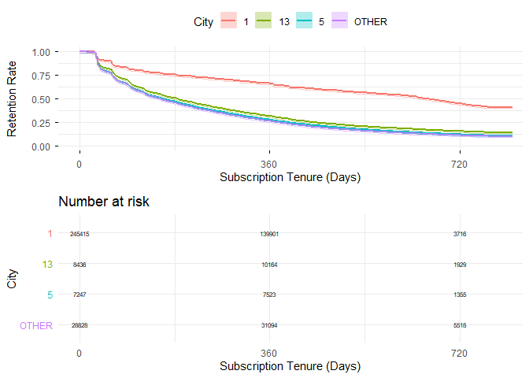
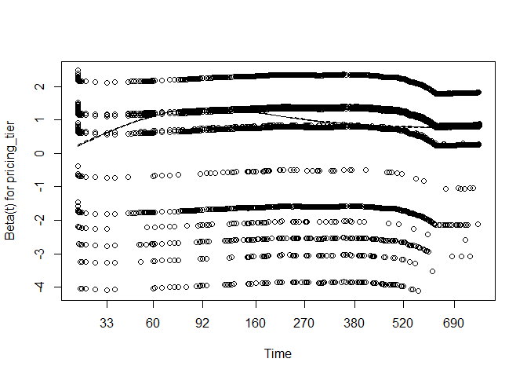
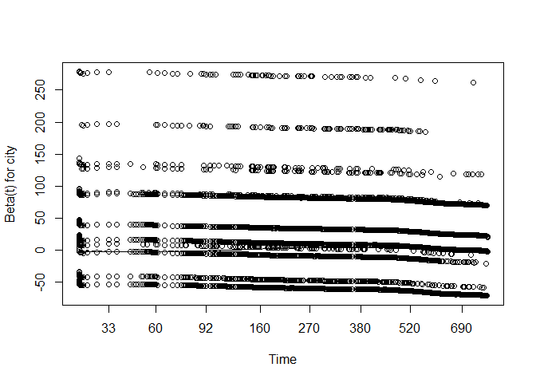
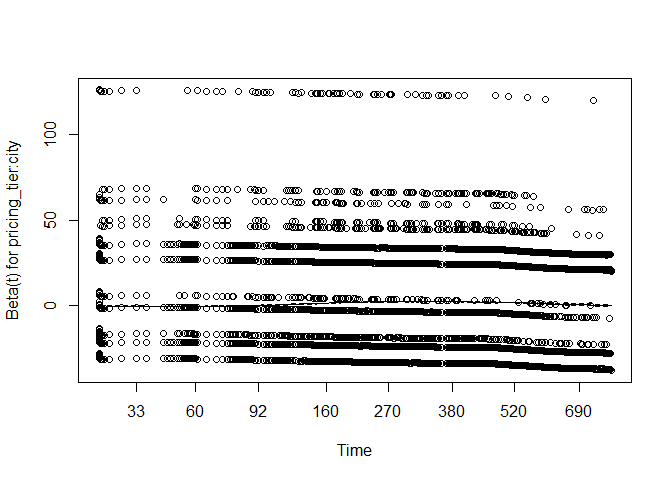

# Churn Analysis

### Loading Packages & Connecting to the Database

``` r
library(dplyr)
```

    Attaching package: 'dplyr'

    The following objects are masked from 'package:stats':

        filter, lag

    The following objects are masked from 'package:base':

        intersect, setdiff, setequal, union

``` r
library(ggplot2)
# for database connection
library(RPostgres)
library(DBI)
# for survival analysis
library(survival)
library(survminer)
```

    Loading required package: ggpubr

    Attaching package: 'survminer'

    The following object is masked from 'package:survival':

        myeloma

``` r
# edit these
DB_NAME <- 'subscription_churn'
DB_USER <- 'postgres'
DB_PASS <- 'postgres'
DB_HOST <- 'localhost'
DB_PORT <- '5432'

con <- dbConnect(Postgres(),
                 host = DB_HOST,
                 port = DB_PORT,
                 dbname = DB_NAME,
                 user = DB_USER,
                 password = DB_PASS)

dbListTables(con)
```

    [1] "events"       "members"      "transactions"

### Loading Data

Joining the members and events tables, using data in or after 2015.
Low-frequency cities and registration methods are grouped under OTHER.
The three most popular tiers, namely NT\\\$99, NT\\\$129, and NT\\\$149,
are chosen to compare.

``` r
df <-dbGetQuery(con, "
  SELECT 
      events.member_id,
      city, 
      registration_method, 
      is_complete_age_gender, 
      tenure_id, 
      avg_price, 
      start_day, 
      end_day,
      event
  FROM events
  INNER JOIN members
  ON events.member_id = members.member_id
  WHERE avg_price IN (99, 129, 149)
    AND registration_date >= '2015-01-01 00:00:00';
"
) %>%
  add_count(city, name = 'city_count') %>%
  add_count(registration_method, name = 'regis_count') %>%
  dplyr::mutate(
    city = if_else(city_count/n() < 0.05,
                   "OTHER",
                   city),
    registration_method = if_else(regis_count/n() < 0.05,
                                  "OTHER",
                                  registration_method),
    pricing_tier = as.character(avg_price)
  ) %>%
  select(-city_count, -regis_count)
head(df)
```

                                         member_id  city registration_method
    1 09O57iWznPC13qytGs69JBEyqvWafKI5LeUrHnyzcds=     1                   7
    2 QuSd6narKNZ/nHBMl8z6PLIhpPUMyh1LeVvRvUmokg0= OTHER                   9
    3 QuSd6narKNZ/nHBMl8z6PLIhpPUMyh1LeVvRvUmokg0= OTHER                   9
    4 zH13n5erjMtC3KDv6d9uwGkRAQGQKeGv0SCEQRAbwzY=     1                   7
    5 uQIsnvanLl/ELREuh9k7U2aXa6gPeIhF4DdQWYzWSiM=     1                   7
    6 m41u/JQydyympt1XLETp2X0kgvGDKjNToRf4yA4qWHc= OTHER                   9
      is_complete_age_gender tenure_id avg_price start_day end_day event
    1                  FALSE         0       149         1     595 FALSE
    2                   TRUE         1       149       515     585 FALSE
    3                   TRUE         0       149        20      80  TRUE
    4                  FALSE         0        99         1     488  TRUE
    5                  FALSE         0       149         1     589 FALSE
    6                   TRUE         2       149       573     586 FALSE
      pricing_tier
    1          149
    2          149
    3          149
    4           99
    5          149
    6          149

### Kaplan-Meier Curves

``` r
surv_obj <- Surv(time = df$start_day,
                 time2 = df$end_day, 
                 event = df$event)

km_fit <- surv_fit(surv_obj ~ 1, data = df)

ggsurvplot(km_fit,
           conf.int = TRUE,
           risk.table = TRUE,
           linewidth = 0.1,
           censor.size = 0,
           break.time.by = 360,
           surv.plot.height = 1,
           risk.table.height = 0.3,
           risk.table.fontsize = 2,
           xlab = 'Subscription Tenure (Days)',
           ylab = 'Retention Rate',
           ggtheme = theme_minimal())
```

    Ignoring unknown labels:
    • fill : "Strata"
    Ignoring unknown labels:
    • fill : "Strata"
    Ignoring unknown labels:
    • fill : "Strata"
    Ignoring unknown labels:
    • fill : "Strata"
    Ignoring unknown labels:
    • colour : "Strata"



Stratifying by pricing tier. It is shown that the higher the price, the
lower the associated retention rate.

``` r
km_price <- surv_fit(surv_obj ~ 1 + pricing_tier, data = df)

names(km_price$strata) <- gsub("pricing_tier=", "", names(km_price$strata))

ggsurvplot(km_price,
           conf.int = TRUE,
           risk.table = TRUE,
           linewidth = 0.1,
           censor.size = 0,
           break.time.by = 360,
           surv.plot.height = 1,
           risk.table.height = 0.4,
           risk.table.fontsize = 2,
           legend.title = 'Pricing Tier',
           xlab = 'Subscription Tenure (Days)',
           ylab = 'Retention Rate',
           ggtheme = theme_minimal())
```

    Ignoring unknown labels:
    • colour : "Pricing Tier"



Stratifying by city. City 1 is associated with a higher retention rate
than the other cities, whereas the retention rates of the other cities
are similar to each other.

``` r
km_city <- surv_fit(surv_obj ~ 1 + city, data = df)

names(km_city$strata) <- gsub("city=", "", names(km_city$strata))

ggsurvplot(km_city,
           conf.int = TRUE,
           risk.table = TRUE,
           linewidth = 0.1,
           censor.size = 0,
           break.time.by = 360,
           surv.plot.height = 1,
           risk.table.height = 0.5,
           risk.table.fontsize = 2,
           legend.title = 'City',
           xlab = 'Subscription Tenure (Days)',
           ylab = 'Retention Rate',
           ggtheme = theme_minimal())
```

    Ignoring unknown labels:
    • colour : "City"



### The Model

A Cox Proportional Hazards Model is used, with the price and city as
covariates. An interaction between them is also introduced.

$$ 
h(t) = h_0(t)\cdot\exp\bigl[\beta_1\cdot\text{pricing\_tier} + \beta_2\cdot\text{city} + \beta_3\cdot(\text{pricing\_tier}\cdot\text{city})\bigr] 
$$

Plotting the Schoenfeld residuals against time, it can be seen that all
the residuals stay relatively constant up till 365 days. That means that
there is no evidence against the proportional hazards assumption for
short term predictions.

``` r
cox_fit <- coxph(surv_obj ~ pricing_tier*city, data = df)
plot(cox.zph(cox_fit))
```







### Results

The pricing tier effects are significant but not the city effects,
except for the marginally significant effect of city 13. Looking at the
interaction effects, the only significant one is the 149 tier in city
13. The churn risk associated with the 149 tier is 1.6665 times that of
the 129 tier, and the risk associated with the 99 tier is 0.2061 times
that of the 129 tier. The churn risk of 149 has 0.7807 times the effect
on city 13 compared to city 1.

``` r
summary(cox_fit)
```

    Call:
    coxph(formula = surv_obj ~ pricing_tier * city, data = df)

      n= 534193, number of events= 223911 

                                  coef exp(coef) se(coef)       z Pr(>|z|)    
    pricing_tier149            0.51070   1.66645  0.01638  31.172  < 2e-16 ***
    pricing_tier99            -1.57917   0.20615  0.01681 -93.957  < 2e-16 ***
    city13                     0.14121   1.15166  0.08266   1.708  0.08758 .  
    city5                      0.07789   1.08100  0.08428   0.924  0.35538    
    cityOTHER                  0.02226   1.02251  0.05155   0.432  0.66589    
    pricing_tier149:city13    -0.24759   0.78068  0.08304  -2.981  0.00287 ** 
    pricing_tier99:city13     -0.11860   0.88816  0.09424  -1.259  0.20819    
    pricing_tier149:city5     -0.03433   0.96625  0.08471  -0.405  0.68527    
    pricing_tier99:city5      -0.04376   0.95719  0.09624  -0.455  0.64936    
    pricing_tier149:cityOTHER  0.04266   1.04358  0.05182   0.823  0.41037    
    pricing_tier99:cityOTHER   0.04227   1.04318  0.05679   0.744  0.45666    
    ---
    Signif. codes:  0 '***' 0.001 '**' 0.01 '*' 0.05 '.' 0.1 ' ' 1

                              exp(coef) exp(-coef) lower .95 upper .95
    pricing_tier149              1.6665     0.6001    1.6138    1.7208
    pricing_tier99               0.2061     4.8509    0.1995    0.2131
    city13                       1.1517     0.8683    0.9794    1.3542
    city5                        1.0810     0.9251    0.9164    1.2752
    cityOTHER                    1.0225     0.9780    0.9242    1.1312
    pricing_tier149:city13       0.7807     1.2809    0.6634    0.9187
    pricing_tier99:city13        0.8882     1.1259    0.7384    1.0683
    pricing_tier149:city5        0.9663     1.0349    0.8184    1.1408
    pricing_tier99:city5         0.9572     1.0447    0.7926    1.1559
    pricing_tier149:cityOTHER    1.0436     0.9582    0.9428    1.1551
    pricing_tier99:cityOTHER     1.0432     0.9586    0.9333    1.1660

    Concordance= 0.734  (se = 0.001 )
    Likelihood ratio test= 194910  on 11 df,   p=<2e-16
    Wald test            = 141151  on 11 df,   p=<2e-16
    Score (logrank) test = 199730  on 11 df,   p=<2e-16

Predicting the median survival times of each tier in city 1. It is not
worth increasing the price to 149 as the churn risk outweighs the extra
revenue.

``` r
survfit(
  cox_fit, 
  newdata = data.frame(
    pricing_tier = c('99', '129', '149'), 
    city = '1')
)
```

    Call: survfit(formula = cox_fit, newdata = data.frame(pricing_tier = c("99", 
        "129", "149"), city = "1"))

      records  n.max n.start events median 0.95LCL 0.95UCL
    1  534193 361312  289926 223911     NA      NA      NA
    2  534193 361312  289926 223911    272     255     278
    3  534193 361312  289926 223911    123     122     123

Even in city 13, the churn risk just barely surpasses the extra revenue.

``` r
survfit(
  cox_fit, 
  newdata = data.frame(
    pricing_tier = c('99', '129', '149'), 
    city = '13')
)
```

    Call: survfit(formula = cox_fit, newdata = data.frame(pricing_tier = c("99", 
        "129", "149"), city = "13"))

      records  n.max n.start events median 0.95LCL 0.95UCL
    1  534193 361312  289926 223911     NA      NA      NA
    2  534193 361312  289926 223911    216     174     278
    3  534193 361312  289926 223911    145     140     151
